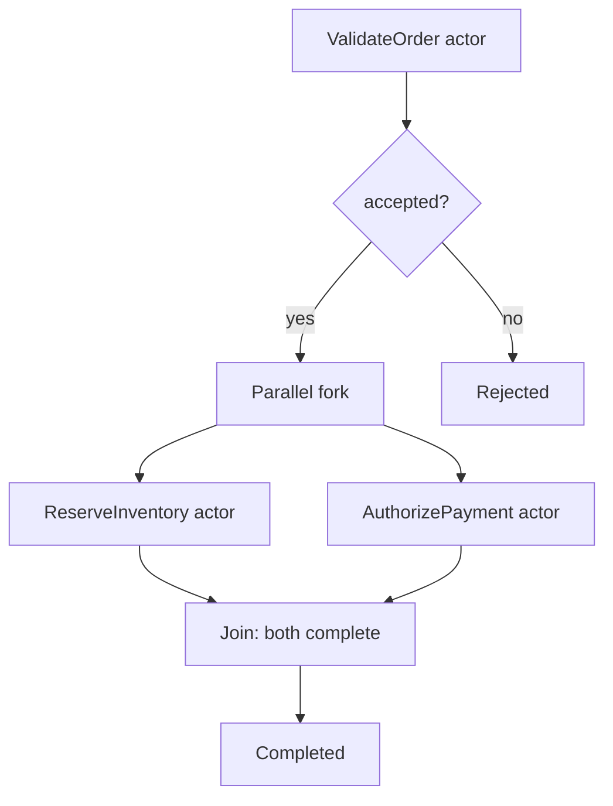
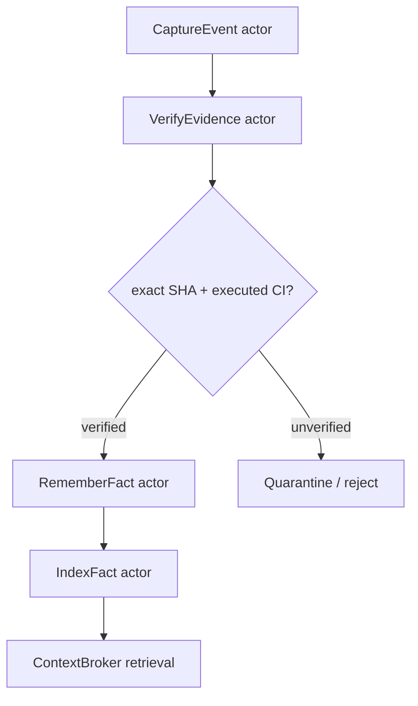
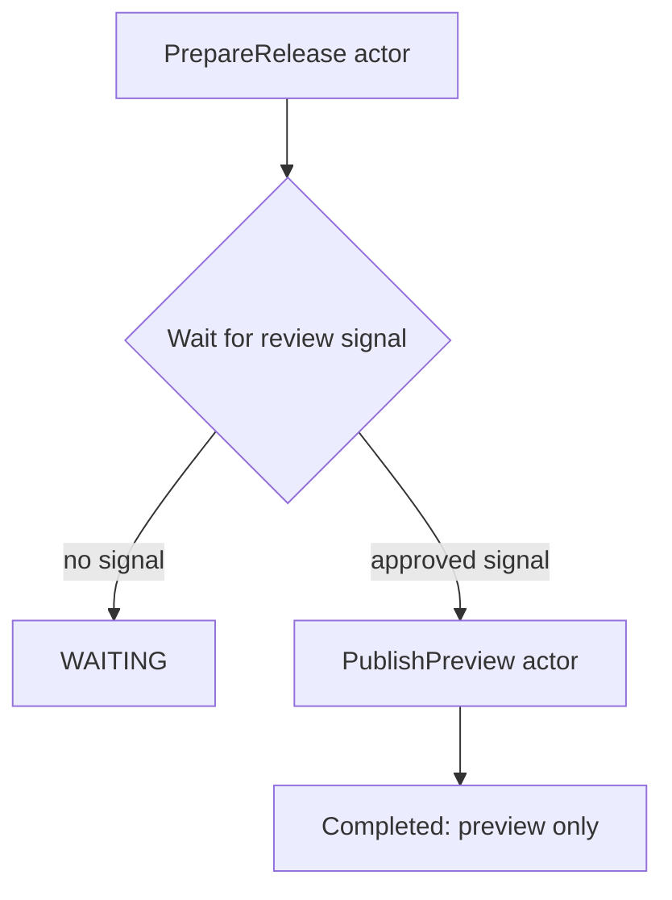

# Step Function graphs and actor pipelines

These Mermaid diagrams correspond to the JSON DAGs under `graphs/`. The diagrams are documentation; the host simulator is under `src/`.

## Order processing: choice + bounded fan-out/join



## AI coding-agent memory: evidence before storage



The `MemoryLedger` is a **process-local simulation**. `VerifyEvidence` requires a separately injected verifier and an internal grant before `RememberFact` can record an event. The CLI verifier only knows a fixed synthetic test event. A trusted production verifier must independently check GitHub run/job evidence, source/actor authorization and freshness; caller-supplied JSON fields are never sufficient.

## Release review: symbolic wait/approval



The simulator restarts from the beginning when run again with a signal; it **does not** resume a durably suspended actor. Signal `authority` is a string placeholder, not cryptographic authentication.

## Oreslang actor pipeline vs durable workflow graph

```text
# Conceptual future syntax. NOT verified guest-compiled:
spawn CaptureStep() pipe spawn VerifyStep() pipe spawn IndexStep()
```

The `pipe` actor-stream concept moves transient values between live actors. The JSON workflow graph instead defines **versioned tasks and durable transition intent**. A production workflow must not treat an actor pipeline as a checkpointed state machine automatically.

## First implementation milestone

1. Execute `examples/oreslang/order-sequential.ores` and `order-parallel.ores` against the real Java/Graal interpreter and confirm exact outputs.
2. Implement a real coordinator actor owning state through `handle_state(critical-read...)` / `critical-write` boundaries; no mutable loan crosses `await`.
3. Add real supervisor CONTROL errors, typed `Result`, bounded cancellation/retry, storage-fenced checkpoints and authenticated human review.
4. Test the frozen graph fixtures on Java, LLVM, .NET, WASM and Forge separately with explicit execution evidence.

## Checkout saga

See [SAGA.md](SAGA.md) for the reserve → authorize → ship example, LIFO compensations, and the reconciliation-required path for ambiguous effects. The native actor sketch is not a durable supervisor or a verified guest runtime.
