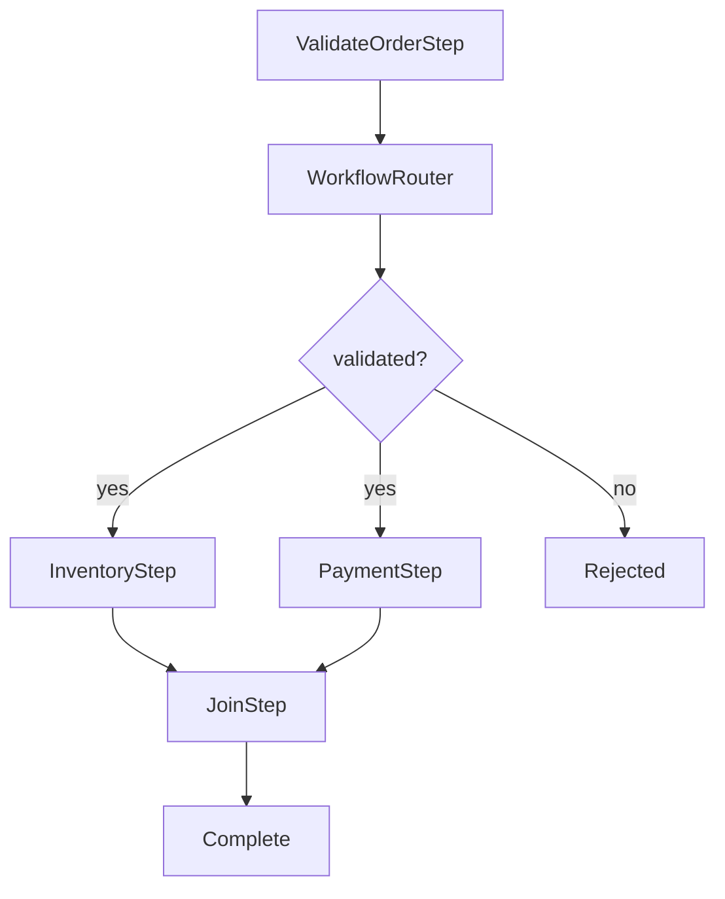
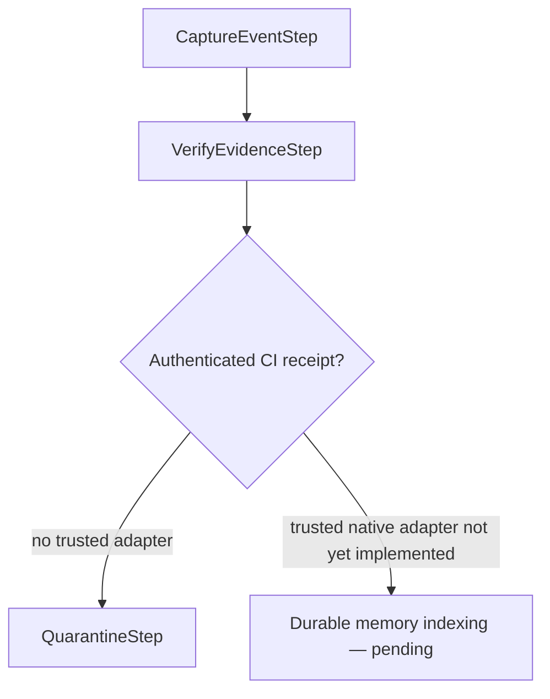
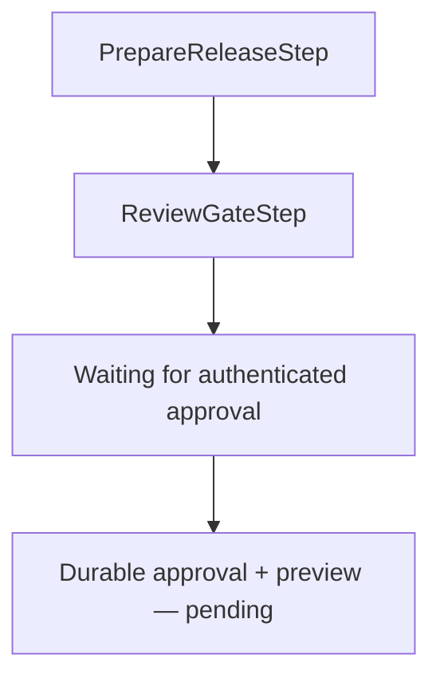

# Oreslang workflow graphs

The **Oreslang implementation** lives in `src/*.ores`; these diagrams
describe its current actor-message flows. The JSON files under `graphs/`
are fixtures for the **Node test reference only**, not executable production
graph definitions.

## Order

## AI coding-agent memory

## Release approval

These are Oreslang actor programs, not durable workflow engine certification.
The current `main()` coordinates child actor messages; a real persisted
`Workflow` coordinator actor and sealed state must be implemented and
guest-tested before calling the engine durable.

## Order saga and compensation

`src/saga_workflow.ores` uses Oreslang actors for reserve, authorize, reject-before-shipment and reverse-order compensation. See [saga details](SAGA.md). JavaScript saga simulation is reference testing only.
