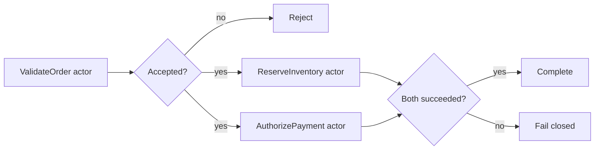
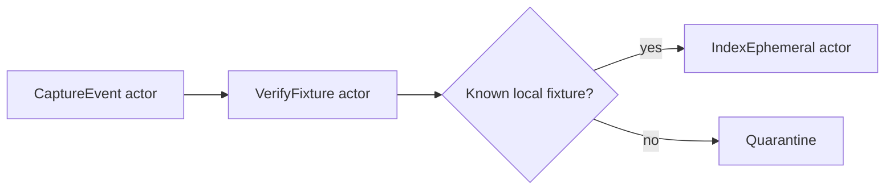
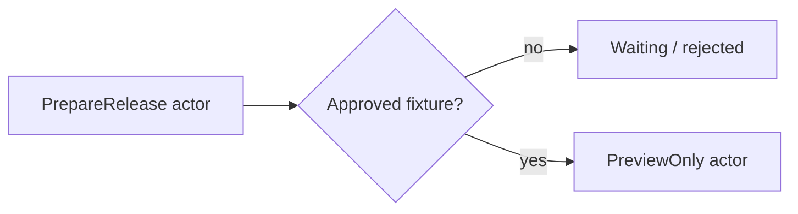

# Graphs executed by native Oreslang programs

These diagrams describe the control flow implemented in `workflows/*.ores`; there is **no** JSON/JavaScript interpreter in the demo.

The memory and approval fixtures demonstrate branching only, not real authentication, persistence, or an AWS-compatible durable execution protocol. The static `graphs/*.json` files are **not** executable definitions.
