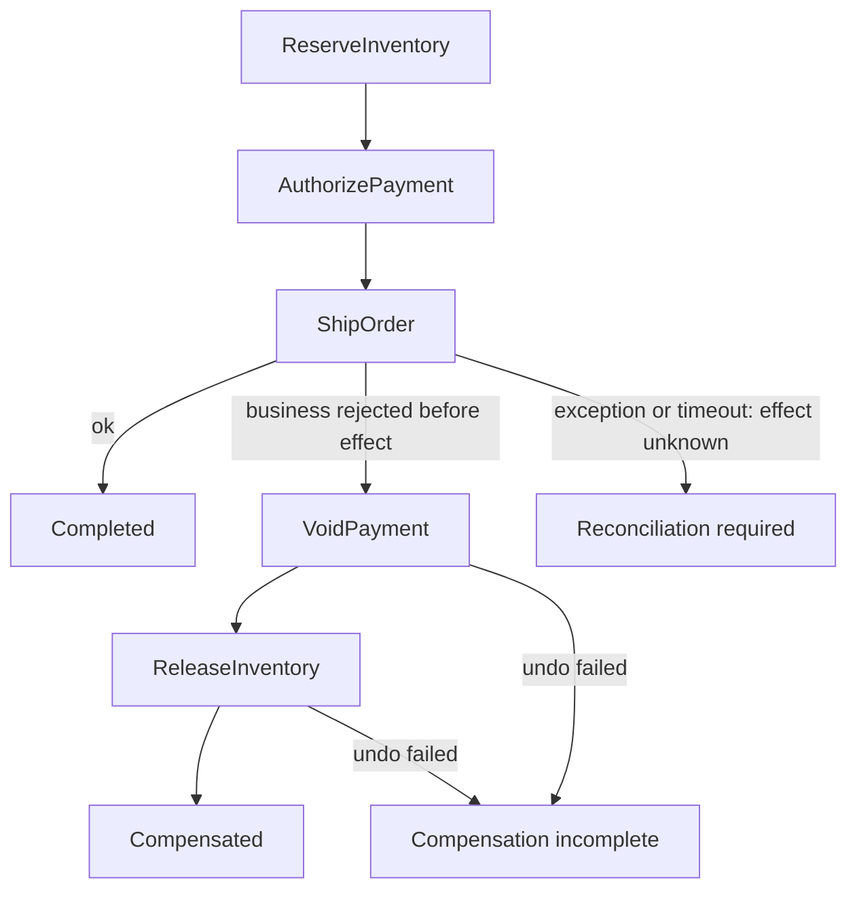

# Checkout saga: reverse compensation across actor steps

`graphs/order-saga.json` is a deliberately separate, operator-owned saga
manifest. Its three forward steps are `reserve → payment → shipment`. The first
two declare compensation actors, executed in LIFO order after an acknowledged,
pre-effect shipping rejection: `void payment → release inventory`.

Run `node scripts/saga-demo.mjs` to view the success, business-rejection and
ambiguous-failure paths. `src/saga-runtime.mjs` uses the bounded task execution
contract in `GraphSimulator` for each actor invocation; it does **not** run or
spawn native Oreslang actors. `examples/oreslang/order-compensation.ores` is a
separate native source sketch pending actual Java/Graal guest execution.

## Contract and caveats

- The saga manifest is **developer-owned**. Do not let request bodies choose
  actor names or compensation actions. Validated identifiers are not an authz
  mechanism.
- Only an acknowledged `ok` step is added to the compensation stack. A known
  `rejected` result means *the rejecting actor performed no external effect*;
  this is a required business protocol, **not enforced by the simulator**.
- A throwing, timed-out, cancelled, or invalid-response step might have already
  performed an effect. The simulator returns `RECONCILIATION_REQUIRED` without
  firing automatic compensation. It cannot stop in-flight actor callbacks.
- Compensation is best-effort and can fail. All remaining undo steps are still
  attempted, and failures result in `COMPENSATION_INCOMPLETE`.
- The state and trace are **process-local**. No transaction log, leases,
  fencing, idempotency key enforcement, outbox, durable pause/resume, secure
  human approval, real payments, or exactly-once guarantees are provided.
- Do not use this host-only example for real external side effects. Production
  requires a fenced durable workflow coordinator, idempotent activity protocols,
  effect receipts and recovery/reconciliation before replay.
